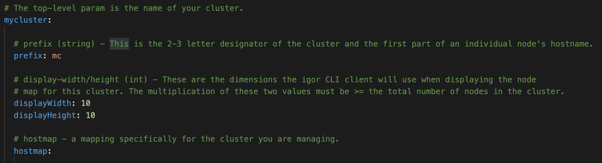
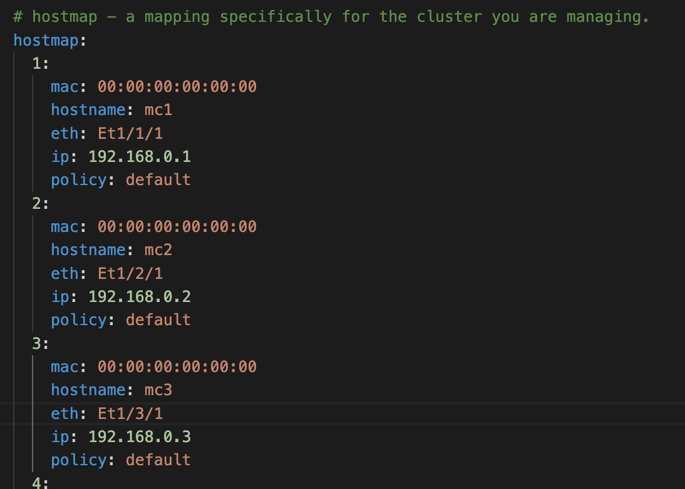

# Setup

## Setting up DHCP

Igor leverages a pre-boot execution environment (PXE) which enables computers in a network to be booted from a server. This requires configuring a DHCP server to point host computers to the PXE server for the resources needed for booting. The following guide describes the steps for setting up such a DHCP server for this purpose.

**Note:** These steps are for a DHCP server assumed to be running a Red Hat distribution. For specifics on setting this under an Ubuntu distribution, please find appropriate documentation online.

### 1\. Install the DHCP server package

Install the DHCP server package using

```shell
yum install dhcp-server
```

### 2\. DHCPv4 server setup

Enter the following configuration to the `/etc/dhcp/dhcpd.conf` file. Replace the addresses to match your network card.

```shell
#
# DHCP Server Configuration file.
#   see dhcpd.conf(5) man page
#

# Try this to turn off excessive log entries
log-facility local6;

# Set default lease time to 1 day
#default-lease-time 86400;
# Set default lease time to 1 hour
default-lease-time 3600;

# With this setting, the dhcpd service answers DHCPREQUEST messages with DHCPNAK if a client
# asks for an address that is outside of the pool.
authoritative;

# for some nodes, the following may be needed:
allow booting;
option domain-name "<dn>";
option domain-name-servers <DNS_IP>;

subnet <SUBNET_IP> netmask <EX.255.255.255.0> {
  option routers <ALT_DNS_IP>;
  ignore unknown-clients;
  filename "/pxelinux.0";
  server-name “server-name.dn";
  next-server <TFTP Server IP>;

  host <hostname>.eth { hardware ethernet aa:aa:aa:aa:aa:aa; fixed-address <HOST_IP>; }
}
```

At the bottom of the configuration, use the template provided and make a host line for each host computer in your cluster.

Note that filename points to `/pxelinux.0`. This is the relative path of the TFTP server which points to a PXE server file delivering configurations for hosts using the BIOS protocol for netbooting. If your hosts boot using UEFI, you would instead have a relative path pointing to the grubx64.efi file. If you have some hosts booting in BIOS while other boot in UEFI, you can specify what hosts should go to the appropriate path using a separate group for UEFI.

```shell
<same as above config>

...

subnet <SUBNET_IP> netmask <EX.255.255.255.0> {
  option routers <ALT_DNS_IP>;
  ignore unknown-clients;
  filename "/pxelinux.0";
  server-name “server-name.dn";
  next-server <TFTP Server IP>;
  #BIOS clients
  host <hostname>.eth { hardware ethernet aa:aa:aa:aa:aa:aa; fixed-address <HOST_IP>; }
  # UEFI clients
  group {
     filename "/uefi/grubx64.efi";
     host <hostname>.eth { hardware ethernet aa:aa:aa:aa:aa:aa; fixed-address <HOST_IP>; }
  }
}
```

### 3\. Start the DHCPv4 Service

Once the configuration above is complete, you can enable and start the service in the console using

```shell
systemctl enable --now dhcpd
```

once you power up your host computers, you can verify their communication with the DHCP server by checking the logs with

```shell
journalctl -u dhcpd
```

## Setting up TFTP

Igor works with the TFTP server to create the appropriate boot config files a host needs which points it to the appropriate boot files. You should install your TFTP server on the same host you plan to install Igor. To setup the TFTP server, do the following

Note: These steps are for a TFTP server assumed to be running a Red Hat distribution. For specifics on setting this under an Ubuntu distribution, please find appropriate documentation online.

### 1\. Create a tftpboot service user

In order to work appropriately with Igor, the TFTP server needs to be setup in a way that Igor can write files to the TFTP path. To accomplish this, you can create a tftpboot user with a `/home/tftpboot` path and serve the config files from this directory.

```shell
useradd -m tftpboot
```

### 2\. Install the tftp-server package

install the required tftp-server package as root using

```shell
yum install tftp-server
```

The installation automatically creates a _tftp_ service and socket file for systemd under `/usr/lib/systemd/system`. You'll need to modify the tftp-server.service file to have the "TFTP root" point to the `/home/tftpboot` directory as follows

```shell
[Unit]
Description=Tftp Server
Requires=tftp-server.socket
Documentation=man:in.tftpd

[Service]
ExecStart=/usr/sbin/in.tftpd -s /home/tftpboot
StandardInput=socket

[Install]
WantedBy=multi-user.target
Also=tftp-server.socket
```

Now, copy both the .service and .socket files to the `/etc/systemd/system/` directory.

### 3\. Allow incoming connections to the TFTP Server

Typically a change to the firewall is required for hosts to be able to connect to the TFTP Server over the network. You can modify the firewall using

```shell
firewall-cmd --add-service=tftp --permanent
```

Without the permanent option, the change is only temporary and will be lost on restart. Depending on the location of the installation ISO file, you might have to allow incoming connections for HTTP or other services.

### 4\. BIOS - Set your pxelinux.cfg path and pxelinux.0 file

Since we modified the TFTP root path in the service file, hosts using BIOS booting will look to `/home/tftpboot` for the pxelinux.0 file. To set this file, access the pxelinux.0 file from the SYSLINUX package in a DVD ISO image file and place it into the `/home/tftpboot` path.

Once a booting host finds the pxelinux.0 file, it then looks for the pxelinux.cfg folder to find its boot configuration file (which Igor writes to). Create this path using

```shell
mkdir /home/tftpboot/pxelinux.cfg
```

### 5\. UEFI - Set your UEFI path and grubx64.efi file

Since we specified in the DHCP config to look for the UEFI grub config file using the relative path `/uefi/grubx64.efi`, we need to make that path

```shell
mkdir /home/tftpboot/uefi
```

copy the grubx64.efi file from `/boot` to the tftp/uefi path

```shell
cp /boot/efi/EFI/redhat/grubx64.efi /home/tftpboot/uefi/
```

### Enable and start the tftp service

With everything configured, you can now enable and start the service with

```shell
systemctl enable --now tftp.socket
```

## Building Igor

Build instructions are covered on the [Download](../download.md) page.

## Installation

As noted in the [Operational Requirements](operational-requirements.md) section, you should have chosen which nodes you want to host each of the executables and obtained certificates for the server and web components.

Igor comes with an installation/upgrade script, _install-igor_ , in the top-level of the igor source code folder that will set up one of more of the executables. It assumes you have used the _build-igor_ script mentioned previously to create an _igor2.tar.gz_ file. The install script assumes sensible defaults based on the type of Linux distro (Debian or RedHat-based) that you are deploying to. Use the help flag to read info on running this script.

By default the install script will create and place the needed YAML config files for each executable in the **`/etc/igor`**  folder. **_These files should be reviewed and edited per the needs of cluster admin team before Igor is run for the first time._** You can read about critical settings in the Post-Install Configuration section below.

### Upgrading Igor

If you already have an earlier version of Igor installed, you can follow the same process of building and installing to do an in-place upgrade. When you run _install-igor_ , it will not change any configuration files for your existing install, but it will provide blank copies of initial configuration files to serve as a reference in case new configuration options become available in the upgraded applications. Review these blank copies for any notes about changes from a previous version.

#### Configuration Upgrades

##### v2.3+ (critical update from previous versions)

In this version a new "powerStatus" field has been added to the **externalCommands** section of _igor-server.yaml_. This new setting works with similar to the other power command fields and retrieves power chassis status for each node. The appropriate command needs to be filled in to retrieve the power status of a single node. For example if you are using ipmitool the command might look like:

powerStatus: "ipmitool -H %v.ipmi -U admin -P  -A password -I lanplus chassis power status"

**_If this command is not present, nodes will appear dark gray indicating their power status is unknown._**

Additionally, the heavy use of polling IPMI status comes with the need to run many such commands in parallel if you have a large cluster. To make polling more efficient, set the

`**externalCommands - > concurrencyLimit**`

setting to something higher than the default. This should help spread the work of issuing power commands to several parallel requests in case one gets hung up waiting for an answer.

#### Database Upgrades

Sometimes a new version of Igor will require the additional step of upgrading the server's database. In this case the server will fail and exit with an error if the internal database version doesn't match what the server needs to run properly.

After running the _install-igor_ script, an unpacked folder named **db-migrate** will be available. Run the _db-migrate_ executable in it. This will back up your existing SQLite database file and then update it. For reference, changes to the database can be examined in the **migrations** sub-folder. If a failure is detected it will roll back from the copy that was made. Otherwise, you should see a message indicating that the database upgrade was successful. You can now start igor-server.

Running the _db-migrate_ app is a safe operation even if it isn't required. If it detects that the database version matches the current release you are installing, no changes will be made.

##### Upgrade versions

The following versions of Igor require running the _db-migrate_ executable after installing an upgrade to the next point release (e.g., 2.0 to 2.1) or major release.

  * `v2.0.x`
  * `v2.1.x`

To see which version of Igor you are currently running, use the following Igor CLI command:

```shell
$ igor -v
```

### Components

#### igor-server (API and Callbacks)

The igor-server application is a REST API server that handles user requests to conduct cluster reservation operations. It writes out PXE configuration files based on currently active reservations for booting nodes with a specified OS image.

The server executable must reside on the head node and runs as the 'igor' system user. It needs access to the network switch for node status and IPMI or other network power control application for node power commands. It must have its designated ports open to communicate with the CLI and web app clients as well as cluster nodes for callback signals.

###

The server's main port is 8443 by default but can be configured otherwise. The callback port is the next highest, so 8444 by default.

The server will send out email notifications to its users. To do this an SMTP server endpoint must be specified in the config file. Emails are designed to be truly informative and not excessive. However, Igor can be configured to not send emails if that is the desired behavior.

The server also receives callbacks from cluster nodes that require additional coordination with Igor. Nodes are required to call this endpoint when doing a local boot action. See the Image Management section for additional details.

#### igor-web

This is Igor's web application, a simple Go HTTPS server running a VueJS front-end client.

###

The igor-web server runs on port 3000 by default but can be configured otherwise.

It can be run on any node that has visibility to the head node or the head node itself. The igor-server will need to know the location of each igor-web instance to enforce CORS rules.

###

As of this release the web app does not yet support administrator commands, therefore the CLI must be used for that subset of operations.

#### igor

This is the CLI client and can be run from any node that has visibility to the head node.

It is recommended to install a copy of it on the head node specifically for sysadmin use. It is generally _not_  advisable to let normal users access Igor from this instance. See the Operational Requirements section for further details.

The CLI client can be installed on as many nodes as needed, including individual users' Linux machines. By default it is installed at **`/usr/local/bin/igor`**  and is accessible to anyone that can login to the machine.

### Make Igor a Service

The install script does not set up the server apps to restart on a host reboot. To do this, we recommend using **systemd** to turn Igor into a service and have provided starter scripts for both the API and web servers in the tar archive. When you run the install script for either the main server or the web app, these files will be unpacked into an **igor-extras/**  folder in your current directory. Customize according to your system needs.

### Log Rotation

The **igor-extras/**  folder also includes an example **logrotate** file for setting parameters around retaining Igor's logs for review purposes. Use and customize this file according to your needs.

## Post-Install Configuration

Next are steps undertaken after you have the executables and configuration files in place but before you run them for the first time.

If you ran the install script, you should not have to do the next two steps, defining IGOR_HOME and setting auto-completion for the CLI if you installed that executable**.**

### Define IGOR_HOME

By default igor executables and users need the environment variable **IGOR_HOME**  defined on the node where they are running and available. This should point to the 'igor' user home directory or some other directory owned by that user.

### CLI - auto completion

When using Igor through the CLI, you can generate a shell source script that can be used for auto-completion of igor commands. Once loaded, tap the TAB key once to auto-complete commands or twice to get suggestions.

```shell
$ igor completion -h
```

### Critical Settings in Config Files

The igor-server.yaml configuration file has a lot of settings that can be tweaked based on the cluster admin team's preferences. This quick guide will only cover the most critical settings to get igor-server running. If you wish to review all settings at this time you can, but the settings listed below will get igor running for first-time setup; others can be adjusted later. Please follow the comments in the YAML file itself for more detailed information.

  * **server**
```shell
* **port**  -- 8443 is the default value, but if it's occupied then specify a different one.
* **cbPort**  -- Auto-increments from the port setting above (i.e., default is 8444), or you can directly specify a different one.
* **certFile**  / **keyFile**  -- The paths to each of these files. A good location is **`/etc/igor/certs`**
* **allowedOrigins**  -- If you are also setting up igor-web you need to specify its `hostname:port` here so that CORS allows requests to go through.
```

  * **auth**
```shell
* **scheme**  -- The default is local. Change this if you are using LDAP for authentication. It is not recommended to change this once you have run the server for the first time.
* **ldap**  -- This entire section is used to configure LDAP if you selected that option under the scheme setting. Review all sub-fields for settings and accuracy.
```

  * **vlan**  -- Fill in this section if you have an Arista switch to support VLAN segmentation on your cluster network.
  * **email**  -- Configuring an email server is highly recommended but optional. The most important fields here are server, port, and username/password if required.
  * **externalCmds**
```shell
* **powerOn**  / **powerOff**  / **powerCycle**  -- These are external commands executed by the OS that tell your IPMI service to perform power operations on cluster nodes.
```

Similarly in the igor-server.yaml file you also need to pay attention to these settings:

  * **webserver**
```shell
* **port**  -- 3000 is the default value, but if it's occupied then specify a different one.
* **certFile**  / **keyFile**  -- The paths to each of these files. A good location is **`/etc/igor/certs`**
* **fileDir**  -- This points to the folder containing the web-app files (JS, CSS, etc.) If you used the default settings of the _install-igor_ script, you should set this parameter to **`/opt/igor/web-content`**
```

The web server requires setting one additional file. In the top level of the web-content folder (set above as the "fileDir" parameter) is a file named **config.json**. The single parameter in this file should point to the igor-server address.**config.json**

```shell
{
   "IGOR_API_BASE_URL": "https://{igor-server host name}:{igor-server port}/igor"
}
```

So if your igor-server is installed the node named `myserver.coolcluster.com` using the igor server's default port, the URL will be `https://myserver.coolcluster.com:8443/igor`

Subsequent uses of the install script will detect the presence of an existing config.json file so as not to overwrite it. If the web-app was working but develops a problem logging into the server, double-check that this file has not been accidentally or unintentionally changed.

### User Authentication

Every Igor user has an account that is independent of their OS user account. This requires an Igor admin to set up that account before a user can successfully login/run a command. By extension if an admin deletes the user's Igor account they will not be able to run commands even though they can still access the node where the CLI client is installed.

#### LDAP

The server can be configured to use LDAP for user authentication if the network supports that service. Other authentication services may be included in future releases.

If using LDAP, the username in Igor must match the username being used in the LDAP service for the same user.

#### Local Auth

In lieu of LDAP, the server can be configured to create and manage local igor passwords. In this case new users will receive email instructions at account creation time to change their password from the default. They may change their passwords through either client. If a password is lost the user can request a password reset from an admin. Users will be advised via email that their igor account can be accessed with a default password and they should change it ASAP.

Local password management operations are separate from and do not work with LDAP or OS authentication mechanisms.

#### Server Authentication Reset

Whichever auth method is chosen, Igor issues a JWT token to the user that is cached by the client with an admin-specified expiration period. As long as the token is present users will not be prompted to login unless they explicitly logout/delete their token or the token has expired.

Because of this caching mechanism, it is possible for a user who has had their Igor account removed to still send commands to the server. If this is a concern, administrators have the option to reset the JWT secret which will invalidate all current tokens and force users to login again.

To reset the jwt secret, use this command in elevated mode:

```shell
$ igor auth-reset
```

## First-Time Start and Login

When igor starts for the first time it will not be aware of the cluster. It will create a new SQLite database and instantiate the local igor-admin account. Someone must log into this account through the CLI to continue setup.

### The 'igor-admin' Account

This is a local super-user account with privilege to run any igor command. The default password is the same as the account name.

In practice you will use igor-admin mostly in these beginning steps and little else. But if an admin doesn't remember their password or connection to the LDAP server is down they can still access igor administrator functions with this local account. Because the account is reachable through any client the password should be changed to prevent unauthorized access and stored somewhere only cluster admin team members can retrieve it from, if needed.

To change the password while logged in as igor-admin run:

```shell
$ igor user edit --password
```

Local igor passwords require at least 8 characters and a mixture of letters, numbers and symbols. Please choose a password in accordance with your organization's best security practices.

While you are here this is also a good time to set an email address associated with this account. It isn't required but it will notify someone if the account password is reset:

`igor user edit -e EMAIL`

Now create the first user account for igor. This should be the person following these instructions and who will be an administrator of the app (see below). The full name is optional but can be handy trying to distinguish someone from their username. It is also used on notification emails.

`igor user create USERNAME EMAIL [-f "FULL NAME"]`

If you configured email correctly, you will receive notice that an account was created for you. If you configured the auth scheme to use local it will also contain the default password users get at account creation. (This can also be looked up/changed in the igor-server.yaml file.)

Additional user accounts can be created at this point if desired, although it is recommended to only do this for users who will also be administrators and delay creating any accounts that could prematurely start using the app before it is fully ready.

### Choosing Igor Administrators

Igor recognizes a class of users who are considered administrators of the application. These users get the same unrestricted access as the igor-admin account. This classification is determined by membership in the **admins**  group. Members of this group are at the cluster admin team's discretion; it could be restricted to sysadmins or expanded to include power-users who are appointed to help normal users with igor-related tasks.

###

Groups within Igor are **not**  Linux OS user groups. Igor administrators do not get any special privileges to run OS-level commands.

Note that the first time any user is added to the admins group it will need to be done as igor-admin because modifying that group's membership is restricted.

`igor group edit admins -a USER1,USER2,...`

When an igor admin wants to run a privileged command, they need to temporarily elevate their status first with the following:

```shell
$ igor elevate
```

Without elevated status igor will treat an admin as a normal user and deny access to restricted operations.

At this point in setup, an igor administrator can log out of the igor-admin account and log back in as themselves. They can continue setup by elevating themselves. If elevated status expires, Igor will notify them the next time they try to use a restricted command. There are also options to check or cancel elevated status. See:

```shell
$ igor help elevate
```

### Loading the Cluster Configuration

The cluster configuration can be set in the _igor-clusters.yaml_ configuration file. Igor follows a naming convention for the names given to the nodes of a cluster. In the config file, the first thing to define is the cluster itself, followed by the nodes in that cluster:

The first label in the yaml file is the name of the cluster.

**prefix** is the common 2-3 id that forms the first part of the cluster hostname.

The **display width** and **height** parameters define how many rows and columns the CLI can use to represent the cluster node map.



For the hostmap itself, there are a set of required fields and a couple optional ones.

**hostnum**  (required/int): - The sequence number and suffix of each node hostname.

**mac** : (required) - The mac address for this host.

**hostname** : (required if different from convention) - Igor assumes the hostname follows the convention <prefix><seq#> ex. with cluster prefix 'bz', the host entered in position 1 has the hostname _bz1_ , position 2 is _bz2_ , etc. If the actual hostname is different, it must be specified here.

**eth** : (required if using vlan segmentation) - The string mapping from hostname to switch ID.

**ip** : (required) - The IP address for this host. Can be IPv4 or IPv6.

**policy** : (only required if not set to _default_) - Name of a host policy that should be applied to this host. Default policy is used if none is specified. It is not required to provide this field when first setting up Igor. Subsequent use of host policies will update your cluster configuration file with the correct policy applied to each node.



Once you are satisfied with the configuration file it's time to load it into igor. Run the command:

```shell
$ igor cluster config
```

Assuming no errors in the formatting, you should see a message that reports that various cluster nodes were identified and created in the database. To verify this you can run

```shell
$ igor cluster show
```

to see the meta information about the cluster and

```shell
$ igor host show
```

to see all the hosts and the information about them that igor took from the config file. Pay special attention to any hosts with an unknown power status. This likely means the host could not be found and it's possible you have an error in its hostname, IP or MACID. Review your cluster config file, make any needed changes, re-run the cluster config command and check the output of host show again.

### Final Steps

As a final step before more involved testing, run the show command. You will notice all nodes display as highlighted with background yellow on the colored node map. Whenever a new node is registered on a cluster its availability is set to _blocked_. This ensures the node cannot be reserved by anyone until the cluster admin team is satisfied it's working correctly.

To unblock the nodes use the following command syntax:

`igor host unblock NODES`

where NODES is a range expression. In this case if your cluster hostname prefix is 'kn' and you have 350 nodes you would put in:

```shell
$ igor host unblock kn[1-350]
```

to make them available.

Igor is now ready! Short of having normal users registered, all functionality should be available. At this point it's a good idea to familiarize yourself with igor's capabilities and uses. You should test loading an OS image into igor, making a distro with it, reserving nodes to run that distro and attempting to boot the nodes with it.
