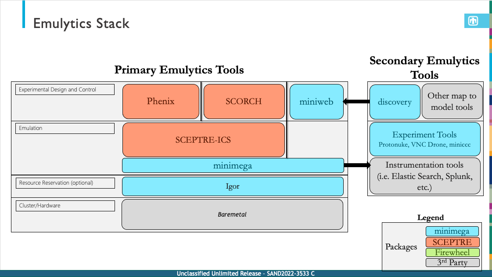

# Igor

Igor is a scheduler for clusters that host ad-hoc multi-user/multi-project work. Users can reserve and provision cluster nodes with net-boot or local-boot images of their choice. Users can also create groups that share access to reservation management. Administrators can fine-tune reservation creation and resource access across a wide variety of settings from open and permissive to regulated and tightly controlled.

The two main goals of Igor are to:

  * Let users control when and how to schedule blocks of time on cluster compute nodes.
  * Remove most of the onerous tasking admins have to do to support usage of cluster resources by different teams with different needs.

Igor is written in the Go programming language and its web application interface in VueJS.

## History

Igor began as part of the Emulytics toolset for [minimega](https://www.sandia.gov/minimega/), itself a tool for launching and managing massive numbers of virtual machines quickly and at scale. It's setup speed could be significantly enhanced by not having to wait for an admin team to approve and provision cluster nodes on which it could run. It could also leverage Igor's ability to communicate directly with the cluster switch system to assign reserved nodes to the same VLAN group. This served the minimega community well in the beginning, but over time a wish list developed among users and admins that pointed to the need for Igor to grow into a more mature tool.

Igor's place in the toolset puts it on the primary Emulytics Stack, installed on the head node of a cluster.

Today, Igor still serves its primary function of procuring nodes for usage in minimega environments. However, it is now a sibling project in recognition that its usefulness extends outside that community to wherever a multi-purpose cluster environment could benefit from its capabilities.

## Support

Need help? Have a suggestion? Need to report a bug? Please use our [GitHub issues page](https://github.com/sandia-minimega/igor2/issues) to communicate with us, and please mark your entry with the appropriate label.

## Release Notes

See [Release Notes](release-notes.md) for the full version history.
