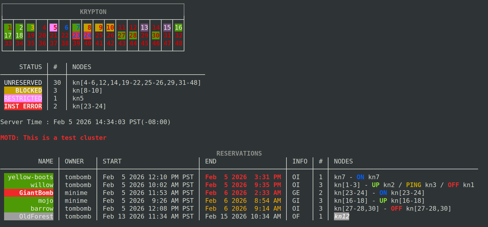
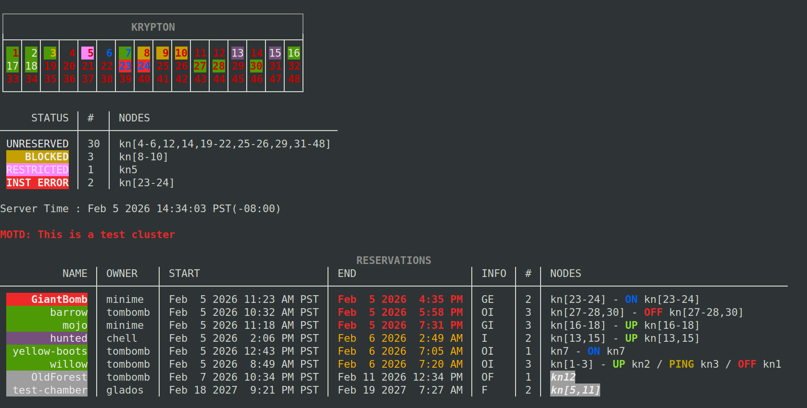

# Getting Started

To begin using this guide it is assumed you already have an account created for you on the Igor instance of the cluster you intend to use. If you do not, contact your cluster admin team to request an account be set up.

The Igor CLI can be run on any Linux node whether it is provided on a network node by the admin team or installed on a PC. As long as the network allows the node to communicate with the Igor server, you should be able to use the CLI. Check with your admin team if they allow users to run their own local version of the CLI.

If you are going to be using your own kernel/initrd pairs with Igor, you will also need to locate those files (or create a file mount) on the same node where the CLI is running.

Once you are logged into the node, all Igor commands begin with `igor`.

The CLI offers integrated help using the `-h | --help` flag on all commands. The syntax

`igor help [command ...]`

is also supported.

Auto-complete for commands is available using the _Tab_ key after `igor` has been entered. Press the key a second time to get suggestions. If you are running the CLI locally and didn't use the install script or are using a shell other than Bash, use the following

```shell
$ igor completion -h
```

to get instructions on how to set it up for your environment.

## Authentication

**New in v2.1** Igor has a standard login command that prompts for your username and password:

```shell
$ igor login
```

While this is easy enough, users can instead type in the Igor command of their choice and bypass the explicit login. Regardless, if Igor determines you don't have an authenticated session then the user will be prompted for their credentials.

### Using the 'login' command for scripting

Due to Igor always checking for authentication on any command, using the login command is not necessary. However it is much more helpful to users who want to call Igor commands in a script. By starting each command list with 'igor login', the user can automate putting in their credentials at a fixed point and ensure that authentication is not triggered on an another command when it isn't expected.

The precise timing of how long an Igor session lasts before re-auth is needed is determined by the cluster admin team.

You can cancel your existing authentication session with the command:

```shell
$ igor logout
```

This is necessary step if you need to access Igor through more than one account.

You can examine information about your last successful connection to the server with:

```shell
$ igor last
```

### Passwords (for local authentication only)

If Igor is set up to use local passwords, users are expected to provide their own for authenticating themselves to the application. The initial email at account registration time will include the default password. Users should take the first opportunity to change to a more secure one in accordance with their organization's best security practices:

```shell
$ igor user edit --password
```

This will invoke the CLI to prompt for the old password and new password, then update their user profile.

### Local Password Requirements

Passwords must be 8-16 characters in length and have a minimum of 1 letter, 1 number and 1 symbol.

If you can't remember your password, you must reach out to an admin and request a password reset on your account. This action will reset your password to the default which should be changed per the command above.

_If LDAP authentication is used, invoking the password change command will inform the user the required password is not managed by Igor._

## Viewing Cluster Status

A quick status of the cluster and its reservations is very simple:

```shell
$ igor show
```

It displays the status of the cluster's nodes along with a list of reservations. In 2.x the default reservation list _only shows reservations you own or have access to via a group_.



There are many additional flags you can include on this command to customize how the information is displayed. Two of the more useful ones are:

**`-a | --all`**  : display all user reservations

**`-c | --current`**  : display only current reservations

The `-a`  flag is similar to the Igor 1.x display where the entire list of reservations by all users is shown:



The `-c`  flag suppresses future reservations from being displayed. Using it along with the `-a`  flag in the above example, the last two reservations highlighted in gray would be suppressed.

The columns are self-explanatory for the most part. The _End_  column highlights reservations that are within 24 hours (**orange**) and 12 hours (**red**) of expiring. The `**-t**` flag can be used to display the column in units of time remaining. The _Info_  column is a shorthand notation for the following:

**O** : you are the owner of this reservation
**G** : you have group access to this reservation
**F** : future reservation
**I** : reservation is installed
**E** : reservation has installation error

These codes can help users understand reservation status if they run with the `-x`  flag that suppresses color in the display output.

The _Nodes_  column is a text version of the power status of nodes in the reservation. Future reservations list the nodes they will be assigned once active and are greyed out to indicate they are not active yet.

### Color Meanings

Additionally, the node map colors have particular meanings.

The foreground (text) color indicates whether the node is fully reachable over TCP (white), responds to ICMP echo/ping (**orange**), power is on (**blue**) or off (**red**) or Igor wasn't able to retrieve the power status (**gray**).

The background color of the cell indicates the reserve status of each node.  Some of these colors are also reflected on the reservation name field tied to each node.

  * **Available (Black)**  - node is free to be reserved
  * **Reserved (green)**  - node is reserved by you or you have group access to its reservation
  * **Not Owned (purple)**  - node is reserved by someone else
  * **Blocked (yellow)**  - node is temporarily unable to take reservations
  * **Restricted (pink)**  - node cannot be reserved due to policy rule
  * **Inst Err (red)** - node has an active reservation but failed to correctly install its specified OS.
  * **Future (gray, not shown on grid)**  - a reservation that isn't active yet

#### Turning off color

If you prefer to run the CLI without using color, the flag

`**-x | --simple**`

can be invoked for monochrome output. This flag is available for almost all sub-commands that display information.

### "Message of the Day"

The show command also has an optional section that can be updated by admins with a message pertinent to cluster users. Orange-colored text is a general alert notice while red indicates a message of high importance.

### More 'Show' Information

For a comprehensive list of display options use the show command's help:

```shell
$ igor show -h
```

Options include sorting and filtering not covered in the descriptions above.

## Additional Cluster Information

The regular show command is perfect for making resevations, but limited in shows information about the hosts themselves. To see detailed information about hosts use

```shell
$ igor host show
```

This command by default will display information about every host on the cluster including each machine's IP address and MAC ID. The command also comes with numerous flags (using the `-h` flag) for filtering if the user is only interested in seeing information about specific nodes in the cluster.

## Server Settings

You can get some basic information about the type of limits that are in place on the server with the command:

```shell
$ igor settings
```

This will display the settings of the following in JSON format:

  * **canUploadImages** : if users are allowed to upload their own
  * **defaultReserveMinutes** : the default number of minutes a reservation will last
  * **hostMaintenanceMinutes** : the default amount of time a node will undergo maintenance after a reservation ends
  * **localAuthEnabled** : if Igor is using local auth (false = LDAP is used)
  * **maxReserveMinutes** : the maximum number of minutes a single reservation can last
  * **maxScheduleDays** : the amount of days from now during which a reservation can be scheduled
  * **minReserveMinutes** : the minimum number of minutes a single reservation can last
  * **nodeReservationLimit** : how many nodes a user can reserve per reservation (0 = unlimited)
  * **vlanEnabled** : if VLANs are supported
  * **vlanRangeMax** : max VLAN id number
  * **vlanRangeMin** : min VLAN id number

As well as being a handy reference, these settings can also be used by scripts if the user wants to automate some aspects of using Igor.

### Elevated Admin-Only

You can see the entire list of server settings (supplied by the YAML config file) by including the **-a** flag to the settings command.

## User Information

As an Igor user, you can access some information about yourself and other users. The following command:

```shell
$ igor user show
```

will display your username, full name (if provided), the date you were registered to use Igor, your email address, and the list of Igor Groups you belong to.

Adding the `**-a**` flag will show the entire list of registered Igor users. You cannot view others' email addresses. Using this command when creating or editing a group helps identify usernames of members.

You can edit two pieces of information on your user profile: your full name and email address. The syntax for this is:

**`igor user edit -f "FULL NAME"`
`igor user edit -e EMAIL`**

Use caution in changing an email address as the email server used by Igor might have restrictions on sending mail to external address. Check with your cluster admin team if you have any questions.

Changing your full name is for informational/display purposes only within Igor and does not affect your login username.
