# Igor-web User Guide

To begin using this guide it is assumed you already have an account created for you on Igor. If you do not, contact your cluster admin team to request an account.

!!! note "Igor Administrator Note"

    At this time Igor-web only supports standard user operations. To run admin
    elevated commands you need to use the CLI client.

## The Default Cluster View

### Light/Dark Mode

Starting with v2.3.1, Igorweb now has a toggle for light and dark mode next the logged in user account name in the upper right-hand corner. This setting is remembered by the browser, so it will persist whenever you re-visit the app.

### Node Map / Reservation List

This view on the right side displays the current status of the cluster in the form of a map of nodes. The datetime indicates the time of the Igor server when the current display was updated.

It also lists all reservations on the cluster, including ones that haven't started yet. Columns can be chosen for sort-order priority.

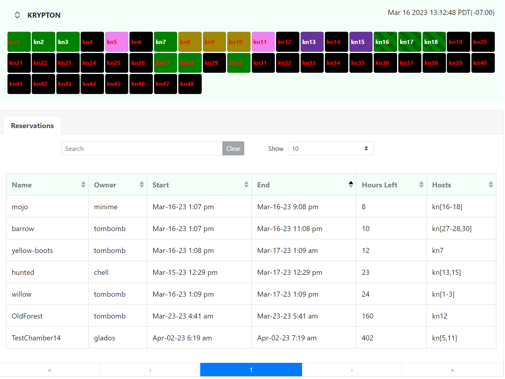

When you click on the cluster's name, you can see a legend indicating color meanings. Clicking again hides it.

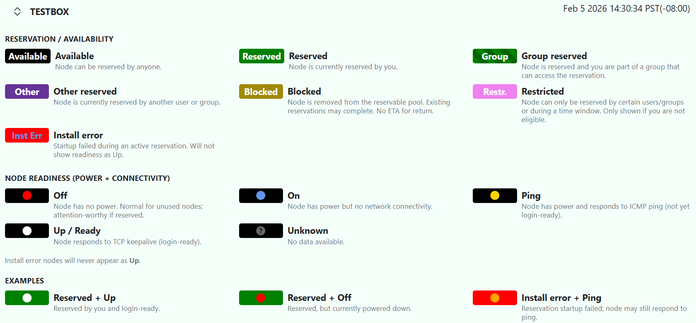

The foreground (text) color indicates whether the node is fully reachable over TCP (white), responds to ICMP echo/ping (**orange**), power is on (**blue**) or off (**red**) or Igor wasn't able to retrieve the power status (**gray**)

The background color of the cell indicates the reserve status of each node.

  * **Available  (black)** - node is free to be reserved
  * **Reserved (green)** - node is reserved by you
  * **Group Resv (striped green)** - node is reserved and you have group access to it
  * **Other Resv (purple)** - node is reserved by another user
  * **Blocked (dark yellow)** - node is unavailable until further notice (no set end time)
  * **Restricted (pink)**  - node cannot be reserved by you due to policy rule
  * **Inst Err (red)**  - node has an active reservation but failed to correctly install its specified OS.

### User Control Panel

The right side of the screen displays several tabs that make up the logged-in user's control panel. The default "home" tab gives a summary of the user's presence on igor including their currently active reservations, profiles and available distros (not pictured, below the "My Reservations" list).

These elements includes controls that allow the user to edit and delete them (or see more details). For reservations there's the additional ability to extend reservation time and send power commands to the nodes

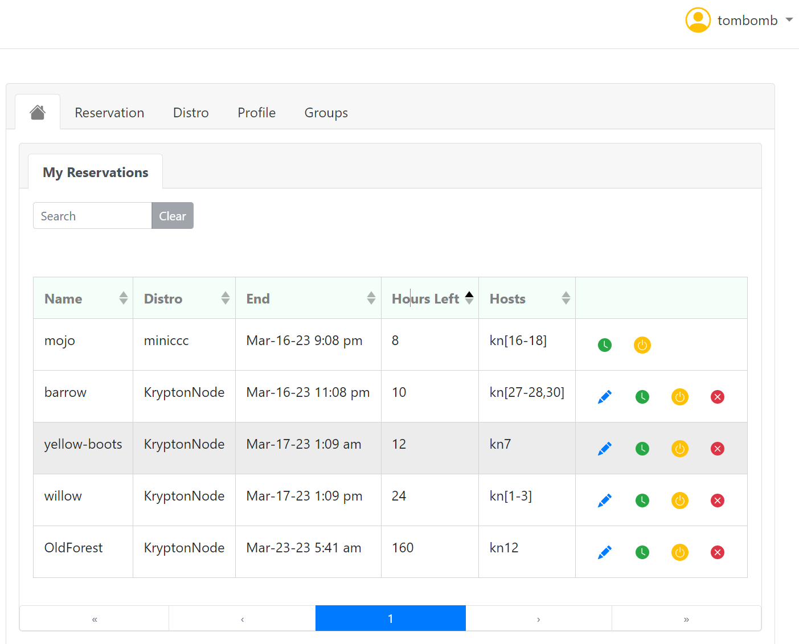

* * *

## Reservations

### Creating a Reservation

#### New Reservation Sub-Panel

To create a new reservation, click on the Reservation tab and start by entering a name and selecting to use either a profile or distro to install on the nodes you will select. The figure below shows the additional prompts you will need to fill in.

#### Hosts Sub-Panel

Of particular note, hosts can be selected by number count – in which can Igor decides which nodes will be used – or with the selection box for picking specific nodes. The selection box method allows you to select nodes from the grid like a standard windows application using Shift and Ctrl keys for individual or ranged selections. The node IDs will populate the selection box. Alternatively you may specify nodes by name, including using range notation similar to the CLI:

```shell
kn14,kn[19-21]
-- OR --
kn14,kn19,kn20,kn21
```

#### Time Start/End Sub-Panel

The text in this sub-panel indicates when and for how long your reservation will be active unless you modify the start and/or end time.

#### Additional Settings

Other fields are optional. If you want to the reservation to be group-accessible, pick the group you want to include in the drop-down list. You may also specify a VLAN either by number or existing reservation name to join that reservation's VLAN.

By default, nodes will power cycle when the reservation starts. If do not want this to happen, check the "Do not power cycle on start" box. This cannot be changed after the reservation has been submitted.

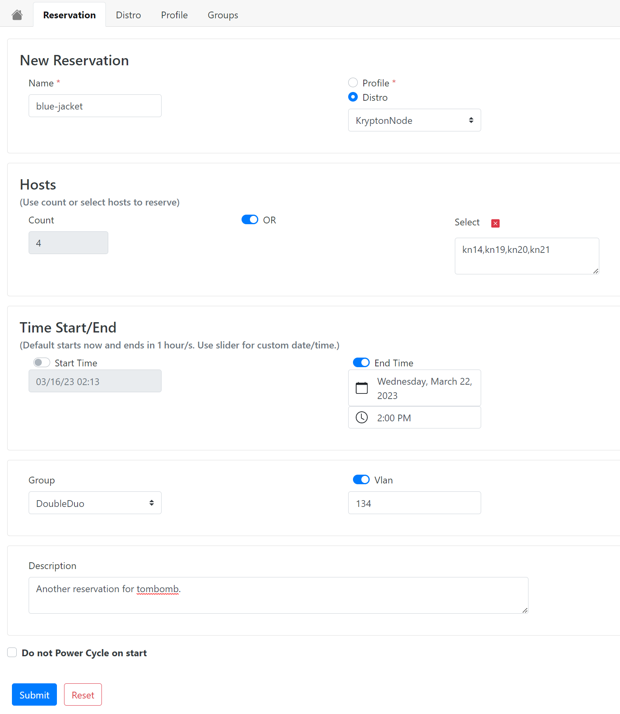

### Power Commands

Power commands can be issued from the main control panel using the power button icon  next to an active reservation. Choose from the associated actions buttons do perform the power command on all nodes in the reservation. If you click the "Hosts" tab you can select a sub-set of nodes to perform the command.

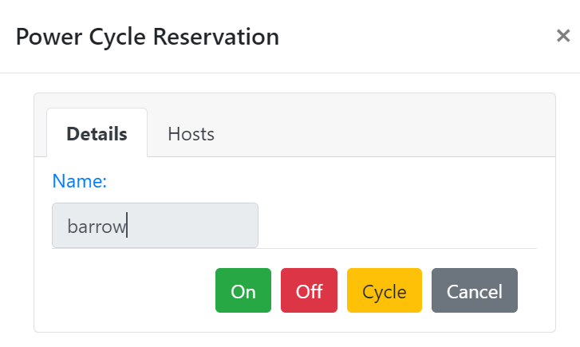

#### Did My Power Command Work?

Power commands are routed through Igor to an external IPMI service that tells igor immediately if the command was successfully submitted. The actual booting of a host can fail for many other reasons. Attempts to power command a node should therefore be followed up with close monitoring to check that the boot completed, sometimes taking as long as a few minutes before the power status changes.

### Editing or Extending a Reservation

If you need to change something in your exiting reservation, you have two options:

#### Extend

Using the timer button icon  you can move the end time of reservation to a later date by selecting a new one. Alternatively select the "Extend Max" button to have Igor schedule a new end time using the maximum amount of your available extend window.

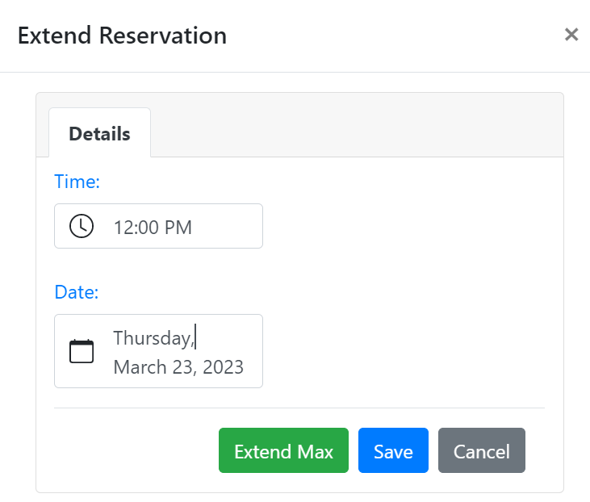

#### Edit

Using the edit button  you can change the reservation's name, owner, group, description or distro. On the "Hosts" tab you can drop hosts from your reservation if they are no longer needed or are experiencing hardware issues.

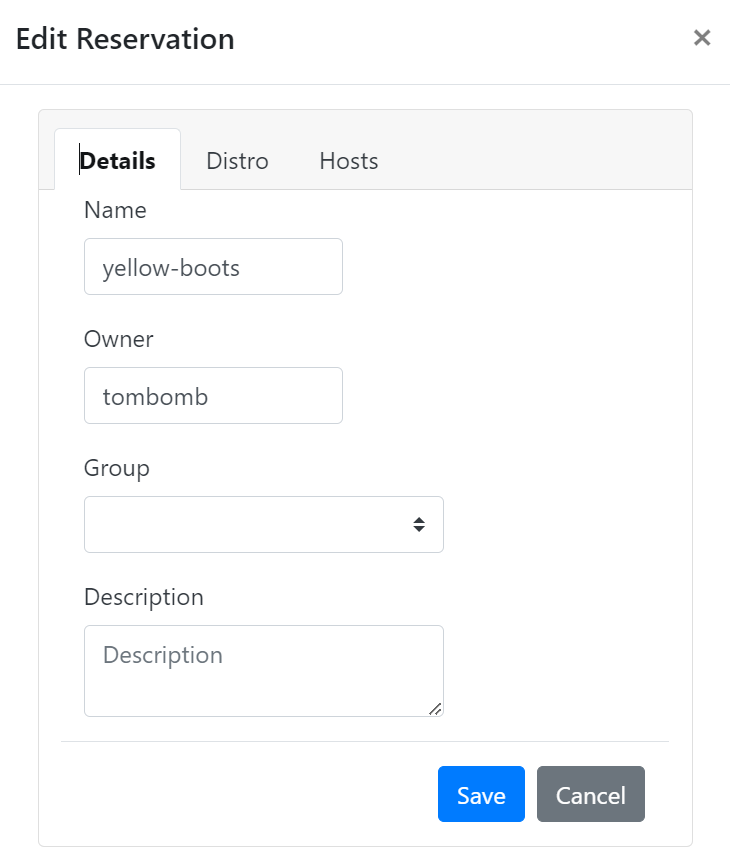

### Deleting a Reservation

To delete a reservation, simply click the delete button  and confirm your action. The reservation will be removed from Igor.

* * *

## Distros

In Igor 1.x, you're probably used to thinking of images in terms of kernel/initrd (KI) pairs which Igor installs to the reservation's node(s) to boot. Igor 2 still uses KI pairs but now wrapped in a "distro". A distro contains a KI pair (image) and other attributes that tell igor how to install to a reservation's node(s). If the image is intended for net booting, you can add kernel arguments to the distro to enhance or supplement the boot process. If the image is intended for local (disk) boot, you can reference a kickstart (or seed) script that has been registered with Igor to allow for automated installation. You can additionally specify groups to the distro that will restrict availability of the distro only to members of the assigned groups.

In order to use a KI pair you've created, you must first register the pair and create a new distro so you can use it in a reservation. New distros are created private by default - only the owner of the new distro can use it, though you can set a distro for public use. Distro names must be globally unique.

### Viewing Distros

Distros that are available to use are listed on the user's home control panel tab in the "My Distros" sub-panel. You can click on the expand icon to get more information about each one.

### Creating a Distro

#### Net-boot vs Local-boot

For net-boot images, follow the instructions below. _Local-boot images require the assistance of a cluster admin team member to be set up correctly._  Contact your admin for instructions on where to send your image files. When the image has been prepared you'll be able to create a distro by following the instructions below using the **Image-Ref**  option.

#### The New Distro Panel

You can create a net-boot distro in different ways.

Choose your option in the "Create From" selection box. Choices include

  1. **Distro** : The new distro inherits the description, image-ref, kernel/initrd file pair, and kernel arguments from an existing distro. User can still modify these fields if included in parameters.
  2. **Distro-Img** : The same as the previous method, but only the underlying kernel/initrd file pair will be used to create the new distro. It will not inherit any other fields.
  3. **Image-Ref** : This method requires a reference ID a user receives from an admin who puts the OS image files on the server for the user. If your cluster admin team screens OS images before they are made available, this option will allow you to create a distro after approval.
  4. **K &I File Pair**: Allows a user to create a new distro by uploading a kernel/initrd file pair directly from their local file system. Specify the path to each file required.

The other required parameter is a unique name for your distro.

##### Optional Parameters

You can add information to the remaining fields as you see fit. As a best practice, you should include only kernel arguments that _must_  be run with this image every time it's used by anyone. Optional or test kernel arguments should instead be used in a profile (see the Profile section below).

##### Making a Distro Public

When you create a distro, it is privately owned by you. Adding groups gives access to users who are members of those groups. However, if you want the distro to be available to _**all**_  Igor users, toggle the "Public" option to true. Public distros allow any user to create a reservation with it, but ownership reverts to the Igor admin team. This cannot be undone, so be certain the OS image you are using is suitable for any user.

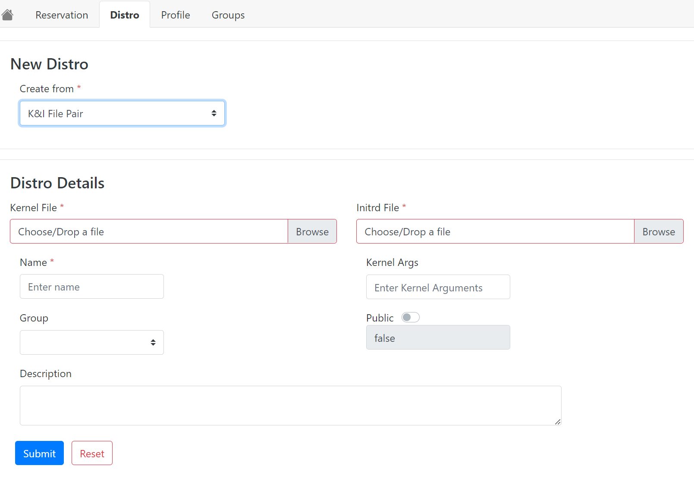

### Modifying a Distro

A distro can be modified by clicking the edit button  and adjusting parameters in the dialog. You can modify an existing distro to change its name, add or remove groups, make it public, add or replace kernel arguments, or update the description.

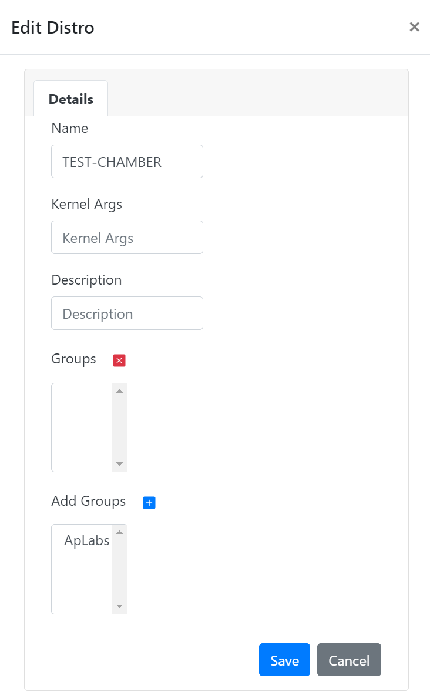

### Deleting a Distro

To delete a distro, simply click the delete button  and confirm your action. The distro will be removed from Igor.

A distro cannot be deleted if it is being used by a reservation. The reservation must end or be deleted first. If the kernel/initrd file pair for the distro you delete is not being used by another distro, those files will also be deleted.

* * *

## Profiles

When Igor boots a distro, it refers to it with a profile. A profile is a simple wrapper around a distro that allows you to insert added kernel arguments to startup, if desired. This allows being able to boot the distro under different conditions without changing the distro itself.

Profiles are specific to users and cannot be shared or made public.

### Viewing Profiles

The profiles you've created are listed on the "My Profiles" tab on the home user control panel and also on the "Profiles" tab. You can check the details of a profile by clicking on the expand icon next to the profile entry.

### Creating a Profile

Any reservation you create by directly using a distro will automatically create a copy of the default profile under your "My Profiles" tab. This profile has no additional kernel arguments and simply instructs Igor to load the bare distro. To create a new profile, fill in the required fields:

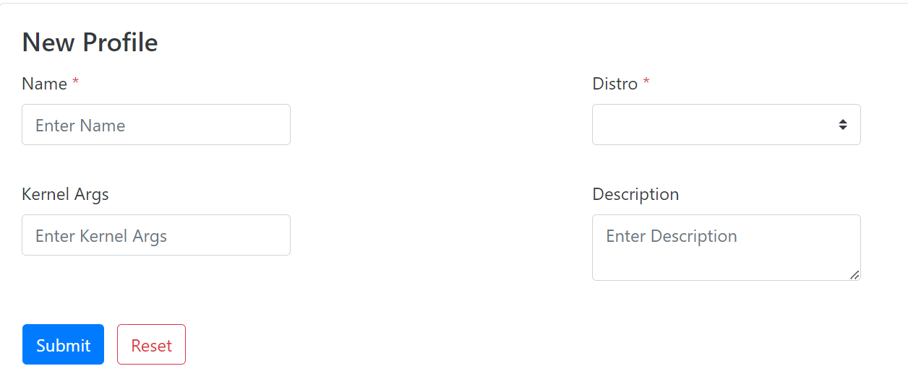

### Modifying a Profile

A profile can be modified by clicking the edit button  and adjusting parameters in the dialog. You can name, kernel arguments and description can all be changed on a profile using the appropriate flags

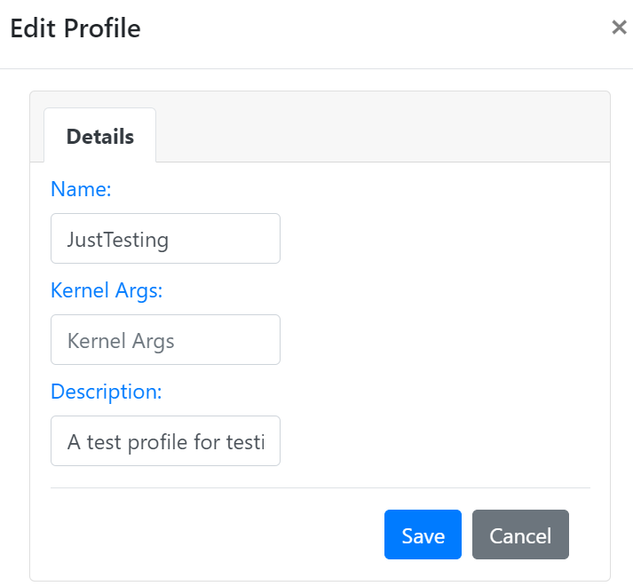

### Deleting a Profile

To delete a profile, simply click the delete button  and confirm your action. The profile will be removed from Igor.

* * *

## Groups

An Igor group is a collection of Igor users. It's that simple. Igor maintains its own process of creating and maintaining groups since this feature is dynamic and can't rely on an outside service like LDAP. Any user can create a group and add members to it. The group owner maintains the power of modifying a group, but they can also transfer ownership to another Igor user, if needed.

Groups are used throughout Igor to provide command and control access to reservations, distros, and other resources for multiple people.

### Viewing Groups

Groups can be viewed, created and edited on the "Groups" tab on the user's main control panel. Details of an existing group may be viewed by clicking the expand icon next to a group on the "My Groups" panel.

### Creating a Group

To create a new group, enter a unique name and then select members by highlighting names in the selection box and using the blue arrow key to move them to the members list. You do not need to add yourself as you will automatically be included as the group owner.

Click the Submit button when you are ready.

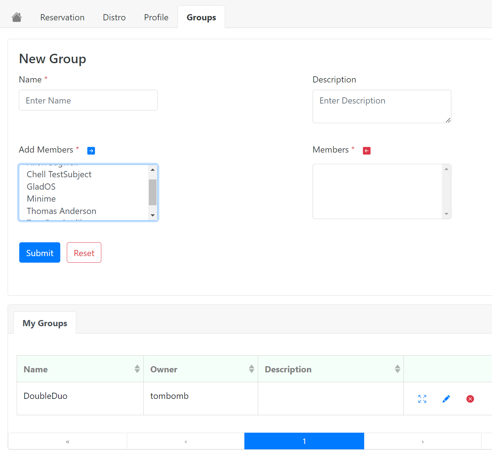

### Modifying a Group

A group can be modified by clicking the edit button  and adjusting parameters in the dialog. You can rename the group, add or delete members, and transfer ownership to another Igor user.

### Deleting a Group

To delete a group, simply click the delete button  and confirm your action. The group will be removed from Igor.

_If you delete a group that is attached to reservations or distros, then that group will be removed from the access list of those resources._
