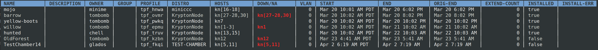
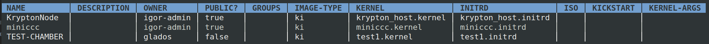

# Reservations

!!! info "Before you go further…"

    The most common use-case is to reserve nodes on the cluster and have them
    boot up with your OS of choice. However, if you don't yet understand what a
    distro is, you should read the [Distros](distros.md) section first.

## Creating a Reservation

The simplest way to create a reservation is with the following syntax:

`igor res create NAME {-d DISTRO | -p PROFILE} -n {integer | expression}`

The reservation **NAME** must be unique. There are also some restrictions on how it can be named (i.e., it can't be all digits and/or punctuation).

Note that you must specify either a profile or distro, not both. The nodes parameter will take either an integer or specific nodes.

**Examples:**

```shell
$ igor res create MyRes -d ubuntu18 -n 5

$ igor res create MyOtherRes -p SpecialBoot -n kn[2-4,7]
```

There are additional (non-required) parameters for start time, duration and VLAN settings. These are covered below.

Once created, you can see its details with a specific reservation show command:

```shell
$ igor res show
```



The information here has differences from the standard show command. Notably, you can see profile/distro information, a column that specifically calls out powered down (or not-available) status of reserved nodes, VLAN assignment and extension history.

### Specifying the Reservation Distro

The command to get a list of available distros:

```shell
igor distro show
```



Igor will display all distros you own and any public or private distros you have access to.

If you'd like to create your own distro using a KI pair, see the [Distro](distros.md) section of the User Guide.

### Specifying the Reservation Profile

The command to get a list of available profiles:

```shell
$ igor profile show
```

All profiles you've created using distros you have access to will be displayed. See the [Profile](profiles.md) section of the User Guide for more details.

### Specifying the Reservation Nodes

The `**-n**` flag sets the nodes to be used and requires either an integer or the specific list of nodes desired.

An integer value will tell Igor to pick that many nodes from the available pool to assign to your reservation. This option will also attempt to pick as many contiguous nodes as possible.

A node list expression can be one of two forms:

  * comma-delimited: _prefix1,prefix2,prefix3,…_
  * range notation: _prefix[n,m-n,…]_ where _m,n_ are integers representing a single node or contiguous range of hosts.

Remember that prefix is the 2-3 letter node name as seen on the main show page.

**More Examples:**

```shell
$ igor res create experiment1 -d debian7 -n 6

$ igor res create experiment2 -p beastmode -n kn5,kn15,kn16,kn2

$ igor res create experiment3 -d opensuse -n kn[3,7-9,22-35,47]
```

### Optional Creation Parameters

Igor will assume your reservation starts immediately upon creation and will last a default amount of time (for example, 3 hours) unless you use the time options outlined below.

#### End Time

The most common time option is specifying how long you wish to keep your reserved nodes. Use the **`-e | --end`** flag with either of two formats:

  * Datetime format**`MMM-dd-yyThh:mm`**. There is no seconds field. Hours use the military range 00-23.
  * An interval specified in days(d), hours(h) and/or minutes(m) in that order. A unitless number is treated as minutes. Days are defined as 24*60 = 1440 minutes and do not take Daylight Savings transitions into account.

**Examples:**

```shell
$ igor res create MyRes -d myiso -n 1 -e Nov-8-23T17:30

$ igor res create MyRes -d myiso -n 1 -e 10d

$ igor res create MyRes -d myiso -n 1 --end 5h30m

$ igor res create MyRes -d myiso -n 1 --end 90  # interpreted as 90m
```

#### Start Time

Less often used is specifying a start time in the future. For this, use the `**-s | --start**` flag and datetime format**`MMM-dd-yyThh:mm`**. Duration notation is not allowed. Only dates in the future are accepted.

**Example with start time of August 31, 2023 at 1:45 PM:**

```shell
$ igor res create FutureRes -d myiso -n 6 -s Aug-31-23T13:45
```

**Combined example (8/31/23 at 1:45 PM to 12/4/2023 at 7:30 AM):**

```shell
$ igor res create NextRes -d myiso -n kn[7-9] -s Aug-31-23T13:45 -e Dec-4-23T07:30
```

#### Adding a Description

A description uses the `**--desc**` flag and is a simple text field for the display of information letting users know more about the reservation beyond its name. Descriptions have some limits on punctuation and have a max of 256 characters.

```shell
$ igor res create MyIsland -d myiso -n 1 --desc "Cast-away simulator"
```

#### Specifying a Group

You can add a group to your reservation. To get started with groups, see the corresponding [Groups](groups.md) section of the User Guide.

Adding a group to a reservation gives its members the ability extend or delete the reservation and to issue power commands to its assigned nodes.

To add a group, use the `**-g**` flag followed by the group name. _You must be a member of the group in order to add it to the reservation._

```shell
$ igor res create StarkTower -d UltronOS -n 2 -g Avengers
```

#### Specifying a VLAN

If a value is not specified when creating a reservation, and VLAN is enabled, Igor will automatically assign a VLAN to the reservation.

To see what VLAN has been assigned to your reservation, use

```shell
$ igor res show
```

when the reservation is active and look under the VLAN column in your reservation details.

If you want to specify your own VLAN, you can first check whether VLAN functionality is enabled and the acceptable range of VLANs available using:

```shell
$ igor settings
```

Then note the VLAN range values in the output.

To use a specific VLAN, include the `**-v | --vlan**` flag and either a number within the range, or the name of an active reservation you own.

If the VLAN value is already in use by a reservation not owned by you, Igor will not create the new reservation.

### Joining multiple reservations

Specifying your VLAN allows for a powerful configuration of having multiple reservations on the same virtual network. This allows users to specify reservation distros using different OS's onto nodes that can communicate with each other. See the example below that creates two banks of nodes, one using Ubuntu 20 and the other using RHEL 8, that join the same VLAN.

**Example:**

```shell
Two reservations that both use VLAN id number 1999.

$ igor res create FirstRes -d MyUbu20 -n 5 -v 1999

$ igor res create SecondRes -d MyRHEL8 -n 3 --vlan FirstRes
```

#### Other Options

_Unless otherwise specified, reserved nodes will immediately begin a**power cycle** operation when the start time is reached and the reservation becomes active._

You can change this default behavior when you create your reservation with the `**--no-cycle**` flag, which will leave the reserved nodes powered off.

```shell
$ igor res create AsleepAtTheWheel -d ubuntu20 -n 2 --no-cycle
```

You may also add kernel arguments with the `**-k | --kernel**` flag when creating your reservation that will be added to the boot parameters of the distro you've specified. This is similar to using a profile, and is offered as a convenience on a per-reservation basis. If you wish to re-use this configuration, it is highly suggested you make a profile to save yourself some typing.

```shell
$ igor res create unstable -d ubuntu20 -n 2 -k "--append=debug"
```

## Editing a Reservation

One a reservation has been created by Igor, the owner may make changes to it at any time before it expires. These include:

  * extending the reservation's end time
  * changing the reservation's name
  * adding or removing a group
  * changing the distro or profile used
  * transferring ownership of the reservation to another user
  * adding nodes to the reservation
  * dropping nodes from the reservation as long as at least one remains
  * adding, changing or removing kernel arguments

Group members may also extend the reservation. This eases the burden on pushing out the expiration time if the owner is not available to do it.

### Extending a Reservation

If your reservation is nearing its end and you still need it, you can extend its end time. _In order to keep access to cluster nodes fair for all users, this type of edit is only available during a specified window of time before your reservation ends._ Typically the cluster admin team will let users know about the extension window they've specified on their cluster user information page. Igor may also send an email when this window starts. If you try to extend before this window is active, the command will report the action was not allowed.

Their are two options for extension. The first allows you to specify the amount of time you need. This is the same as the end time field used when creating a reservation:

`igor res edit NAME --extend {datetime | duration}`

**Examples:**

```shell
$ igor res edit MyNodes1 --extend Jan-27-24T03:25

$ igor res edit MyNodes2 --extend 10d8h
```

The second option allows you to extend a reservation out to it's maximum extra time by letting Igor figure out when that end time occurs. This is useful if you expect your reservation to need the most extra time you can get. The max reservation length can be found by running the server settings command. The syntax is:

`igor res edit NAME --extend-max`

### Extensions are not guaranteed

An extension cannot be honored if another user has reserved one or more of the nodes you are using during the extension window you've requested. If the lack of extension would cause a serious disruption, contact your cluster admin team for assitance.

### Changing a Reservation Name or Description

`igor res edit NAME {-n | --name} NEWNAME`
`igor res edit NAME --desc "TEXT"`

```shell
$ igor res edit StarkTower -n AvengersHQ

$ igor res edit AvengersHQ --desc "moved to the new base of operations"

$ igor res edit AvengersHQ --desc "Jarvis does not like it here"
```

### Changing or Removing a Group

`igor res edit NAME {-g | --group} {GROUP|none}`

The word "none" is reserved to drop a group. (Thus, a group named "none" cannot be created either.) When adding/changing a group, the owner must be a member of that group.

```shell
$ igor res edit AvengersHQ -g HydraJanitors

$ igor res edit AvengersHQ -g none
```

### Changing the Distro or Profile

`igor res edit NAME {-d | --distro} DISTRO`
`igor res edit NAME {-p | --profile} PROFILE`

```shell
$ igor res edit AvengersHQ -d VisionOS

$ igor res edit AvengersHQ -p TonysTestJarvis
```

_Note that after this change is made it will not take effect until the reservation 's nodes are power-cycled, if already active_.

### Transferring Ownership

Sometimes a reservation may need to be handed over to a new owner. In a case like this the original owner (or an elevated admin) can specify an Igor user as the new owner. After this change the previous owner can no longer edit the reservation. The previous owner will
retain some access rights if they are a member of the reservation's assigned group.

The new owner must also be a member of the associated group, if one is attached to the reservation.

`igor res edit NAME {-o | --owner} USER`

```shell
$ igor res edit AvengersHQ -o srogers
```

### Adding NodesNew in v2.2

Users are allowed to add nodes to their reservation after creation up to the allowable limit as defined by the Igor's administrative settings. This can help users who may underestimate the number of nodes needed and want to directly add them to a reservation rather than creating a new reservation and joining it to the same VLAN ID as the previous reservation.

Added nodes will be powered on using the same parameters the original reservation and will share the same VLAN ID as other nodes in the reservation.

`igor res edit NAME --add NODES`

```shell
$ igor res edit AvengersHQ --add ucc[1-2,7]

$ igor res edit AvengersHQ --add ucc32,ucc41
```

### Dropping Nodes

This allows allows reservation owners and admins to free up nodes without deleting the
reservation using it. In some cases, the owner may determine some nodes are no longer needed and can be returned to the reservable pool. In another, this might be a necessity if a node has to be taken offline due to hardware failure.

The drop operation cannot be used if the result would be the cancellation of all nodes in the reservation. In this case the reservation should be deleted instead.

`igor res edit NAME --drop NODES`

```shell
$ igor res edit AvengersHQ --drop ucc[4,9-10]

$ igor res edit AvengersHQ --drop ucc22,ucc25
```

### Adding or Changing Kernel Arguments

`igor res edit NAME --drop NODES`

```shell
$ igor res edit AvengersHQ -k "--append=debug"

$ igor res edit AvengersHQ -k ""
```

## Deleting a Reservation

A reservation can always be deleted before it expires. Issue the following command:

`igor res del NAME`

```shell
$ igor res del Experiment47
```
